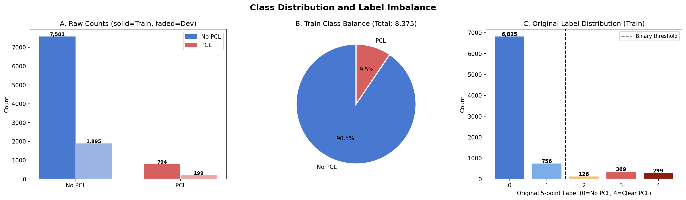
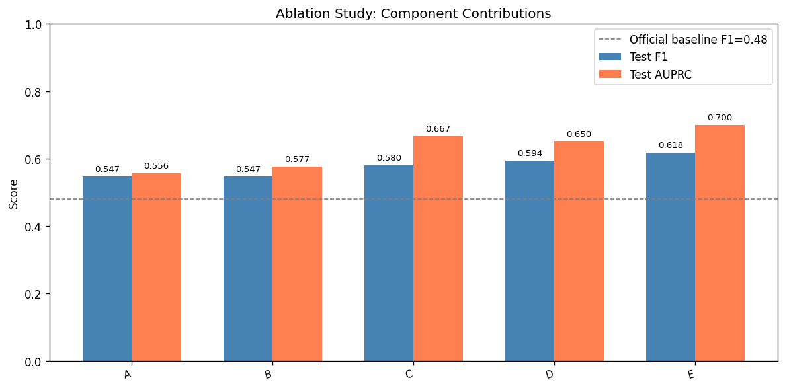
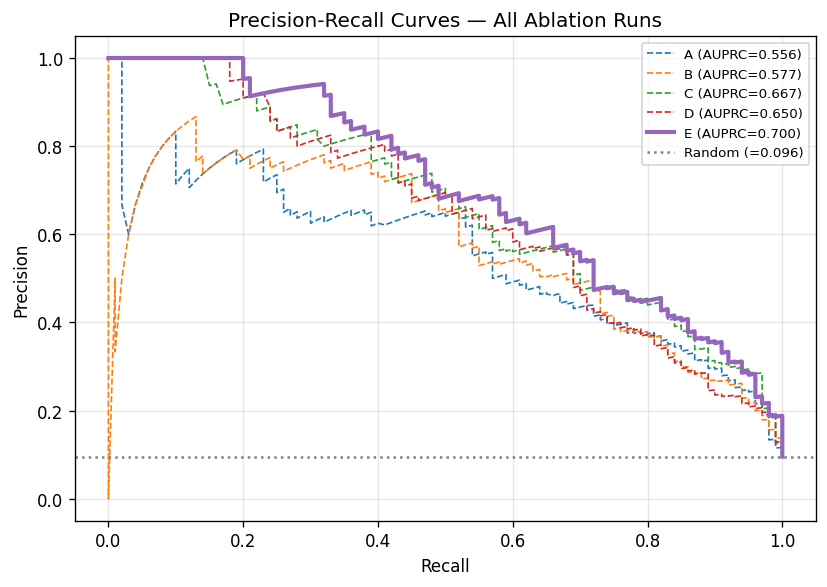
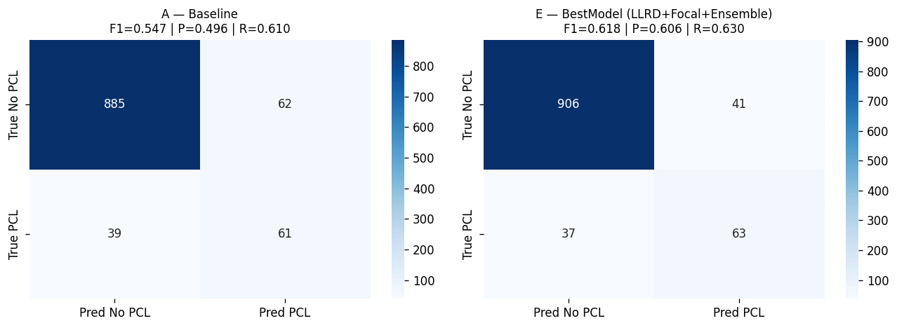

# Natural Language Processing: Patronizing And Condescending Language Detection With RoBERTa


Detection of patronizing and condescending language (PCL) towards vulnerable communities in news paragraphs: SemEval-2022 Task 4, Subtask 1. A fine-tuned RoBERTa-large with layer-wise learning-rate decay, a focal loss, a 3-seed ensemble and a calibrated decision threshold reaches a PCL-class F1 of **0.62**, against 0.48 for the task organisers' RoBERTa-base baseline. Natural Language Processing module, MSc Computing (Artificial Intelligence & Machine Learning), Imperial College London, 2026.

**Author:** [Parnian Fazel](https://github.com/parnianf)

## Task and data

Given a paragraph from a news article, predict whether it contains PCL (binary classification). The data come from the *Don't Patronize Me!* dataset: news paragraphs about vulnerable communities (for example refugees, homeless people and women), annotated for PCL.

Exploratory analysis shaped the design:

- **Severe class imbalance:** only 794 of 8,375 training paragraphs (9.5%) are PCL, so accuracy is uninformative. F1 of the PCL class and the area under the precision-recall curve (AUPRC) are used instead.
- **Metadata carries signal:** the PCL rate varies strongly by search keyword (from 2.7% for *immigrant* to 17.2% for *homeless*) and by country.
- **Label noise:** borderline annotations are pooled into the positive class, which is why AUPRC, not F1 at a fixed threshold, is used for model selection.



## Approach

RoBERTa-large fine-tuned with four components, each motivated by a finding from the analysis:

| Component | What it does | Settings |
|---|---|---|
| **Context-enriching prompt** | Prepends the keyword and country code to every paragraph (`Context: {keyword} in {country}. Statement: {text}`), so every layer can use the metadata | no extra parameters |
| **Layer-wise learning-rate decay (LLRD)** | Smaller learning rates for lower layers, which keeps general language knowledge while adapting the upper layers | top rate 1e-5, decay 0.95 per layer |
| **Alpha-balanced focal loss** | Down-weights easy negatives and focuses on hard boundary cases | α = 0.8, γ = 2.0 |
| **3-seed soft-voting ensemble with threshold calibration** | Averages the probabilities of three models (seeds 42, 7, 21); the decision threshold is tuned on a development set rather than fixed at 0.5 | τ = 0.3345 |

Other settings: maximum length 256 tokens, effective batch size 8, weight decay 0.01, 10% warm-up, at most 6 epochs with early stopping on development AUPRC (patience 2), mixed-precision (fp16) training.

**Data splits.** Training uses the official training set. The official development set is split 50/50 (stratified) into an internal development set (1,048 paragraphs), used for model selection and threshold calibration, and a held-out internal test set (1,047 paragraphs) for local evaluation. The official test set has no public labels; its predictions are in `test.txt`.

## Results

On the held-out internal test set (1,047 paragraphs, 100 of them PCL), the final ensemble reaches **PCL-class F1 = 0.618** (precision 0.606, recall 0.630) and **AUPRC = 0.700**, while keeping the majority class strong (No-PCL precision 0.961, recall 0.957). The task organisers' RoBERTa-base baseline scores F1 = 0.48 on the official development set.

An additive ablation shows what each component contributes (same seed for runs A–D; run E adds the ensemble):

| Run | LLRD | Focal loss | Ensemble | Dev AUPRC | Test AUPRC | Test F1 | Precision | Recall |
|---|---|---|---|---|---|---|---|---|
| A: baseline (cross-entropy, flat learning rate) | | | | 0.571 | 0.556 | 0.547 | 0.496 | 0.610 |
| B: + focal loss | | ✓ | | 0.635 | 0.577 | 0.547 | 0.545 | 0.550 |
| C: + LLRD | ✓ | | | 0.669 | 0.667 | 0.580 | 0.561 | 0.600 |
| D: + LLRD and focal loss | ✓ | ✓ | | 0.676 | 0.650 | 0.594 | 0.588 | 0.600 |
| **E: + 3-seed ensemble (final model)** | ✓ | ✓ | ✓ | 0.695 | **0.700** | **0.618** | 0.606 | 0.630 |



- **LLRD is the most useful component** (C vs. A: +0.111 AUPRC, +0.033 F1).
- **Focal loss alone only trades recall for precision** (B vs. A: F1 unchanged). It helps once LLRD gives stable representations (D vs. C: +0.014 F1), so the order of the components matters.
- **The ensemble adds the final gain** (E vs. D: +0.050 AUPRC, +0.024 F1) by smoothing the probability estimates of the three seeds, whose individual development AUPRC scores are 0.672, 0.671 and 0.661.
- Run D's test AUPRC is slightly below run C's even though its F1 is higher: adding the focal loss shifts the best development threshold a lot, and a single threshold does not optimise both metrics.



### Error analysis



Compared with the baseline, the final model fixes 46 paragraphs and introduces 23 regressions (a net gain of 23); 55 paragraphs are wrong for both, which is the hard core of the dataset. Most of the missed PCL paragraphs contain PCL-related vocabulary in a context that reads as advocacy (for example a speaker demanding rights or support for a community), where telling support from condescension needs more pragmatic knowledge than the model has.

## Repository structure

```
├── EDA.ipynb                              # exploratory data analysis (figures are saved to Plots/)
├── BestModel/
│   ├── best_model.ipynb                   # full pipeline: prompt, LLRD, focal loss, 3-seed training, calibration, predictions
│   └── ablation_and_evaluation.ipynb      # ablation runs A–E, precision-recall curves, confusion matrices, error analysis
├── dev.txt                                # predictions for the official development set (0 = no PCL, 1 = PCL)
├── test.txt                               # predictions for the official test set
├── Plots/                                 # exploratory-analysis figures
├── results/                               # figures used in this README
└── requirements.txt
```

## Reproducing the results

1. Install the dependencies (Python 3.10+; training RoBERTa-large needs a GPU with at least 16 GB of memory):

   ```bash
   pip install -r requirements.txt
   python -m spacy download en_core_web_sm
   ```

2. Download the data into the project folder. The datasets are not redistributed here; please follow their terms of use.

   ```bash
   git clone https://github.com/Perez-AlmendrosC/dontpatronizeme.git
   git clone https://github.com/CRLala/NLPLabs-2024.git
   ```

   The notebooks expect `dontpatronizeme/semeval-2022/` (practice splits and test file) and `NLPLabs-2024/Dont_Patronize_Me_Trainingset/` (the training TSV files) in the project root.

3. Run `BestModel/best_model.ipynb` to train the three seeds (checkpoints are written to `checkpoints/`), calibrate the threshold and write `dev.txt` and `test.txt`.
4. Optionally run `BestModel/ablation_and_evaluation.ipynb` for the ablation, curves and error analysis, and `EDA.ipynb` for the exploratory analysis.

The fine-tuned model weights are not stored in the repository because of their size.

## Reference

C. Pérez-Almendros, L. Espinosa-Anke and S. Schockaert, *Don't Patronize Me! An Annotated Dataset with Patronizing and Condescending Language towards Vulnerable Communities*, COLING 2020. SemEval-2022 Task 4: [task website](https://sites.google.com/view/pcl-detection-semeval2022/). Y. Liu et al., *RoBERTa: A Robustly Optimized BERT Pretraining Approach*, 2019.
